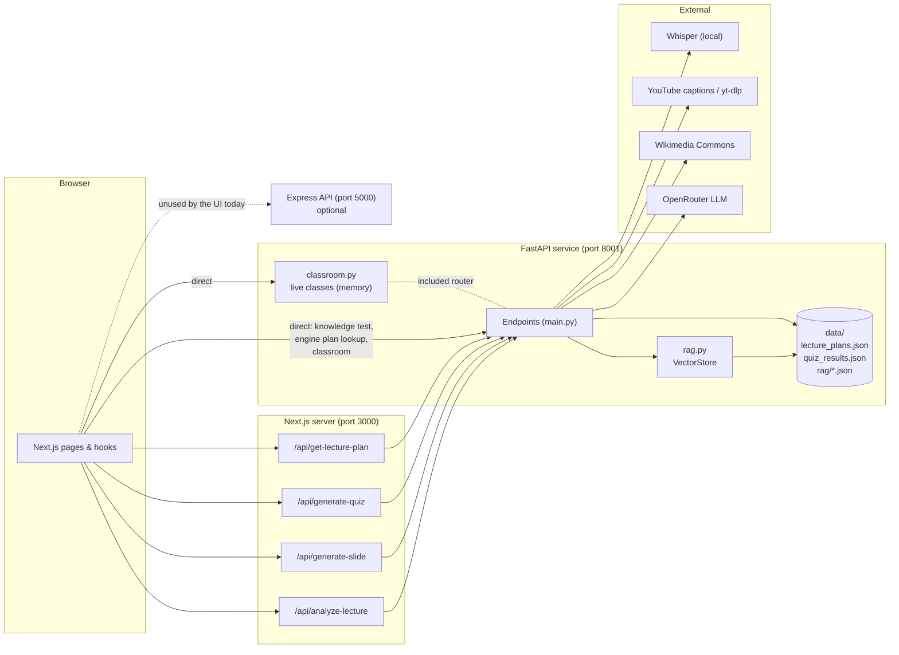
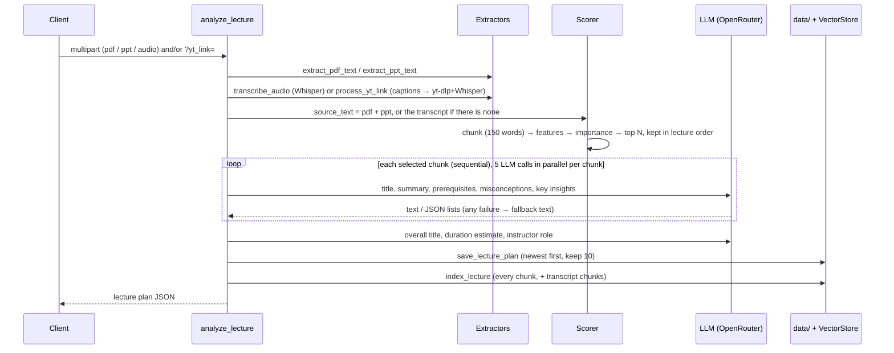
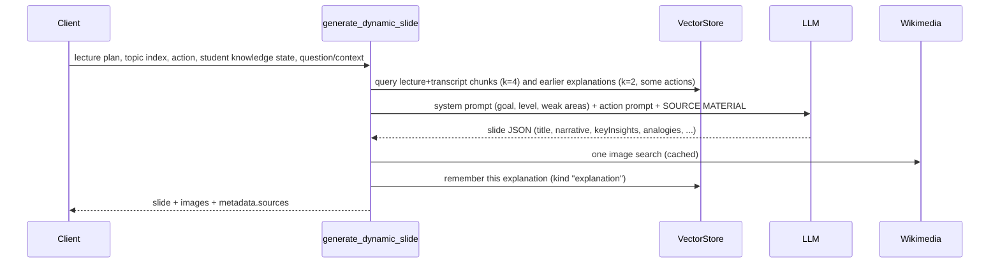
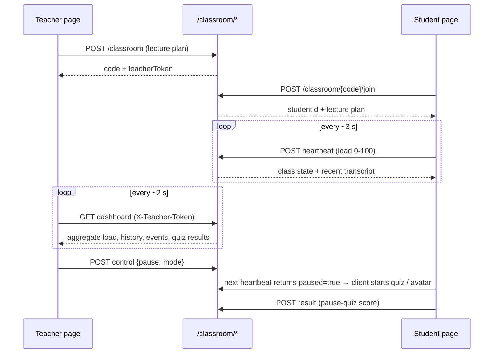

# Architecture

## 1. Components



* The browser reaches FastAPI **two ways**: through thin Next.js proxy routes (lecture upload, slides, quizzes,
  plan lookup) and **directly** (knowledge test, classroom polling). That is why FastAPI enables CORS for the
  web origin (`CORS_ORIGINS`).
* `classroom.py` is a FastAPI `APIRouter` mounted into the same app (`app.include_router(classroom.router)`),
  so there is still only one Python process.
* The Express API is independent of FastAPI. Nothing in the current web UI calls it.

## 2. Source layout

```
backend/
├─ docs/                      ← you are here (+ generated openapi.json)
├─ fastapi-service/
│  ├─ main.py                 app, models, extraction, scoring, LLM helpers, slides, quizzes, endpoints
│  ├─ rag.py                  VectorStore (TF-IDF / dense retrieval, JSON persistence)
│  ├─ classroom.py            live-classroom router and in-memory state
│  ├─ export_openapi.py       regenerates docs/openapi.json
│  ├─ test_api.py             lecture / MCQ / quiz / slide / storage tests (26)
│  ├─ test_features.py        retrieval, classroom, grounding tests (21)
│  ├─ requirements.txt
│  └─ .env.example
├─ src/                       Express API (server.js, routes/, models/, config/)
└─ package.json
```

`main.py` is organised in labelled sections, in this order: env → app/CORS → Pydantic models → lazy ML
models → OpenRouter config → extraction helpers → text processing → LLM helpers → analysis/plan building →
MCQ generation → storage + retrieval helpers → slide generation → endpoints → startup.

## 3. Data flows

### 3.1 Lecture analysis (`POST /analyze-lecture`)



### 3.2 Slide generation (`POST /generate-dynamic-slide`)



### 3.3 Live classroom



## 4. Concurrency model

* FastAPI endpoints that do blocking work are declared with plain `def` (not `async def`) so Starlette runs
  them in its thread pool and the event loop stays free. This applies to `analyze_lecture`,
  `generate_dynamic_slide`, `generate_diagnostic_mcq`, `generate_topic_quiz`, `rag_query` and all classroom
  endpoints.
* Inside one request:
  * `build_topic` runs its **5 LLM calls in parallel** (`ThreadPoolExecutor(max_workers=5)`); topics are
    built one after another, so analysing N topics makes about `5N + 3` LLM calls.
  * `generate_diagnostic_mcq` generates questions in parallel (`max_workers=4`).
* Shared state is protected by locks:

| Lock | Protects |
|---|---|
| `_model_lock` | one-time loading of the Whisper and sentence-transformers models |
| `_file_lock` | read-modify-write of `lecture_plans.json` and `quiz_results.json` |
| `VectorStore._lock` (re-entrant) | collections in memory and their JSON files |
| `classroom._lock` (re-entrant) | the whole live-class registry |

* **Run a single worker process.** Live classes are kept in memory and the model caches are per process, so
  `uvicorn --workers N` with N > 1 would split classes across processes.

## 5. Optional components and graceful degradation

| Missing / failing | Effect | Where handled |
|---|---|---|
| `OPENROUTER_API_KEY` unset, bad key, timeout, 5xx | Plan topics use extractive titles/summaries and empty insight lists; MCQs use templates; `generate-topic-quiz` returns **503** (client falls back); slides return **502** (client falls back) | [ai-generation](features/ai-generation.md) |
| `openai-whisper` not installed | Audio uploads and caption-less YouTube videos return **501** | `get_whisper_model` |
| `ffmpeg` not installed | Whisper cannot decode audio → request fails with a transcription error (**422** for YouTube, 500 for direct audio) | [lecture-ingestion](features/lecture-ingestion.md) |
| `sentence-transformers` not installed / fails to load | Importance uses a constant semantic score of 0.5; retrieval uses TF-IDF | `get_semantic_model` |
| `yt-dlp` not installed | YouTube videos *with* captions still work; others return **501** | `process_yt_link` |
| Wikimedia unreachable | Slides have no image (`images: []`) | `search_commons_image` |
| Data directory not writable | `save-quiz-results` returns 500; plan saving raises (the upload fails) | [storage](features/storage.md) |
| Retrieval indexing raises | Logged and ignored; the upload still succeeds | `analyze_lecture` |

## 6. Security model

| Concern | Current behaviour |
|---|---|
| Authentication on lecture / slide / quiz endpoints | **None.** The service trusts its caller (the Next.js app). Do not expose port 8001 publicly without a gateway that authenticates requests |
| Classroom authorisation | Teacher actions need the `X-Teacher-Token` returned when the class was created (`secrets.token_urlsafe(24)`, compared with `secrets.compare_digest`). Students are identified only by a random id |
| Student privacy in a class | The dashboard returns **aggregates only**. Names and per-student signals are stored in memory but no endpoint returns them |
| CORS | Allowed origins from `CORS_ORIGINS` (default `localhost:3000/3001`, `127.0.0.1:3000`); credentials allowed |
| Secrets | Only `OPENROUTER_API_KEY`, read from the environment / `.env`. It is never logged and never returned by any endpoint (`GET /` only exposes a boolean `ai_configured`) |
| Uploads | Written to a temp file, parsed, then deleted in a `finally` block. No size limit is enforced by the service; put one in the reverse proxy |
| Prompt content | Lecture text and student questions are sent to the configured LLM provider. Treat uploaded material as shared with that provider |
| Outbound requests | Only OpenRouter (`OPENROUTER_URL`), Wikimedia Commons, YouTube (captions / yt-dlp) |
