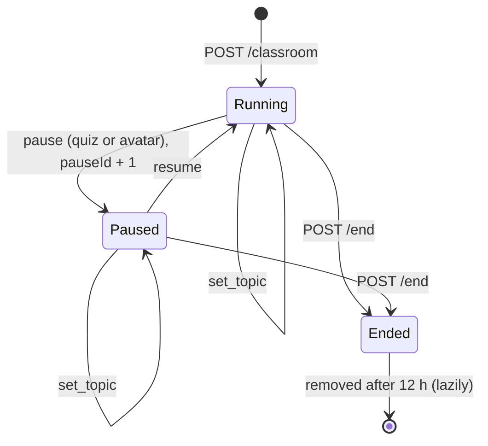

# Feature: Live classroom

A teacher publishes a lecture to a class; students study it live and report how hard it is for them; the
teacher sees the class's combined cognitive load and can pause everyone for a quick quiz or an avatar
explanation.

* **Endpoints:** [`/classroom/*`](../api/classroom.md)
* **Code:** `classroom.py` (an `APIRouter` included by `main.py`)
* **Storage:** process memory only ([storage](storage.md))

## 1. Roles and what each can do

| Role | Identified by | Can |
|---|---|---|
| **Teacher** | `teacherToken` (returned once by `POST /classroom`) sent as `X-Teacher-Token` | view the dashboard, change the topic, pause / resume, add transcript text, end the class |
| **Student** | `studentId` (returned by `join`) | send heartbeats, report quiz scores |
| **Anyone with the code** | the 6-character code | join, read the public state |

## 2. Lifecycle



* A class starts on topic 0, not paused, `pauseId = 0`.
* `set_topic` changes the topic **without** resuming or pausing.
* Every `pause` increments `pauseId` and opens a new bucket for quiz results, so scores of different pauses
  never mix. Pausing while already paused simply starts a new pause.
* `end` is idempotent. After it: `join` and `control` return 410; heartbeats and `state` still work so that
  students learn `ended: true`; the dashboard stays available for the final report.

## 3. What the client does with the state (contract)

The state object (`code, topicIndex, paused, pauseMode, pauseId, ended, teacherName`) is returned on every
heartbeat. The web app implements this contract:

| Server state | Student client behaviour |
|---|---|
| `topicIndex` changed | jump to that topic |
| new `pauseId` with `pauseMode: "quiz"` | start the topic quiz, passing `recentTranscript` as context, then `POST /result` with the score |
| new `pauseId` with `pauseMode: "avatar"` | open the avatar and generate a `simplified-explanation` slide, passing `recentTranscript` |
| `paused: true` | lock navigation (Next / Previous) |
| `ended: true` | show "This class has ended" |

Polling rates used by the web app: students heartbeat every **3 s**; the teacher dashboard polls every **2 s**.
The server itself imposes no rate limit.

## 4. Cognitive-load aggregation

Each heartbeat stores `load` (0-100, clamped), `level` and `lastSeen` for the student.

* A student is **active** if `now − lastSeen ≤ 20 s` (`ACTIVE_WINDOW_S`). Students who close the tab drop out
  of the aggregate within 20 s but still count in `joined`.
* `averageLoad` = mean `load` of active students (1 decimal).
* `levels` counts active students per level; `highRatio = levels.high / active` (2 decimals).
* **Overload rule:**

```
overloaded = active > 0  AND  (highRatio ≥ 0.4  OR  averageLoad ≥ 70)
```

  (`OVERLOAD_RATIO = 0.4`). The 70 threshold catches a uniformly stressed class where nobody individually
  crosses the "high" bar.
* `level_for(score)`: ≥ 65 → `high`, ≤ 35 → `low`, otherwise `medium`. It is used when a client sends an
  invalid `level`.

### History

At most every **5 s** (`HISTORY_STEP_S`, triggered by a heartbeat) the class average is appended to a history
`{t, averageLoad, active, high}`. 720 samples (one hour) are kept; the dashboard returns the last 120. The
teacher's chart is drawn from this.

## 5. Lecture-audio context

The teacher's browser may capture speech and call `POST /transcript` with recognised sentences (≤600 chars
each; the last 200 segments are kept). `recentTranscript` is the segments from the **last 180 s** joined, cut to
the **last 1800 characters**. It is delivered to students in heartbeats and used as context for pause quizzes
and simplified explanations ("what the teacher just said"). The audio itself never reaches the service.

## 6. Pause-quiz results

`POST /result` stores `score` per `(pauseId, studentId)`; resubmitting overwrites. The dashboard's
`quizResults` maps `pauseId → {responses, averageScore}` so a teacher sees how well the class understood
after each pause.

## 7. Event log

Kept per class: `class_started`, `student_joined`, `topic_changed`, `paused`, `resumed`, `class_ended` (each
with `t` in Unix seconds). The web app turns it, plus the history and quiz results, into the downloadable
class report.

## 8. Privacy

Per-student data (name, load, signals) is held in memory to compute aggregates. **No endpoint returns it.**
The dashboard shows counts per level, an average and a chart only. Student names are optional and are never
shown to the teacher.

## 9. Limits and housekeeping

| Item | Value |
|---|---|
| Concurrent classes | 200 (`MAX_CLASSES`) → 503 beyond that |
| Lifetime | 12 h (`CLASS_TTL_S`); expired classes are purged **when the next class is created** |
| Code | 6 chars from `ABCDEFGHJKLMNPQRSTUVWXYZ23456789`, unique among live classes |
| Student id | 12 hex characters |

## 10. Failure modes & operations

* **Server restart ends every class.** Students get `404 Class not found...` on their next heartbeat and
  the teacher's saved token no longer works; the teacher must start a new class and students rejoin.
* **Multiple workers split classes.** Run a single process.
* Network blips: clients simply retry on the next poll; there is no server-side session to repair.
* There is no way to remove an individual student or to rotate a leaked teacher token other than ending the
  class.

## 11. Scaling notes

Load grows with students × (1 heartbeat / 3 s) and the teacher's 1 poll / 2 s. Each heartbeat is O(active
students) because the aggregate for history sampling is recomputed at most every 5 s; a few hundred students
per class is comfortable on one process. For more, move the state to Redis and fan out with WebSockets.

## 12. Tests

`test_features.py`: `test_create_requires_topics_and_returns_code`, `test_student_joins_with_code_and_receives_the_plan`,
`test_dashboard_requires_the_teacher_token`, `test_aggregate_flags_overload_when_many_students_are_struggling`,
`test_inactive_students_are_left_out_of_the_aggregate`, `test_pause_quiz_reaches_students_and_results_are_collected`,
`test_control_validation`, `test_transcript_window_keeps_only_recent_audio`,
`test_ending_a_class_blocks_new_students`, `test_unknown_student_heartbeat_is_rejected`,
`test_history_is_sampled_not_per_heartbeat`.
