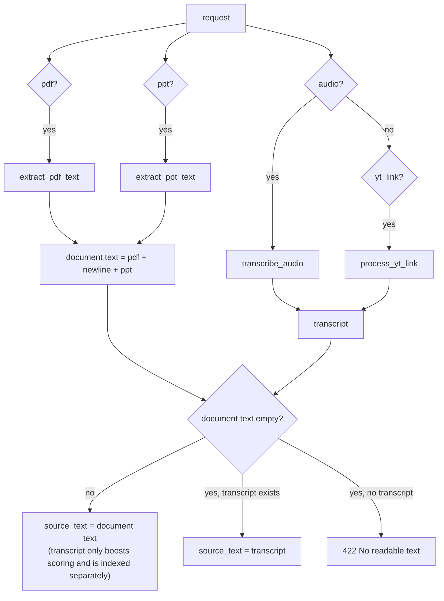

# Feature: Lecture ingestion

Turns the four supported inputs (PDF, PPTX, audio, YouTube) into plain text for the rest of the pipeline.

* **Endpoint:** [`POST /analyze-lecture`](../api/lecture-analysis.md)
* **Code:** `main.py`: `_save_upload`, `extract_pdf_text`, `extract_ppt_text`, `transcribe_audio`,
  `extract_video_id`, `process_yt_link`, and the orchestration in `analyze_lecture`
* **Next stage:** [topic scoring & plan building](topic-scoring-and-plans.md)

## 1. How inputs are combined

| Combination | Lecture text used for topics | Transcript used for |
|---|---|---|
| PDF and/or PPTX | document text | importance boost + separate `transcript` retrieval chunks (if audio/YouTube was also sent) |
| PDF/PPTX + audio | document text | same |
| Audio only | the transcript | (it *is* the text; not indexed twice) |
| YouTube only | the transcript | same |
| Audio **and** YouTube link | audio wins; the link is ignored | |

## 2. Per-format behaviour

### PDF: `extract_pdf_text`

* Saved to a temp file (suffix `.pdf`), opened with **pdfplumber**, `extract_text()` per page, pages joined
  with newlines. The temp file is always deleted (`finally`).
* **No OCR.** A scanned PDF without a text layer yields empty text.
* Any pdfplumber exception (corrupt, encrypted) becomes **422** `Could not read the PDF file: ...`.

### PowerPoint: `extract_ppt_text`

* Only **`.pptx`** (python-pptx). The upload's own suffix is kept; `.pptx` is the default.
* Reads `shape.text` for every shape that has it (titles, text boxes, placeholders, auto-shapes) on every
  slide, one shape per line.
* **Not read:** table cells, grouped shapes, charts, SmartArt, images, speaker notes.
* Failure → **422** `Could not read the PowerPoint file (only .pptx is supported): ...`.

### Audio: `transcribe_audio`

* Saved to a temp file keeping the original suffix (default `.wav`) and transcribed with the lazily loaded
  Whisper model (`WHISPER_MODEL`, default `base`). Language is auto-detected.
* Whisper decodes through **ffmpeg**, which must be on `PATH`. Any format ffmpeg understands works
  (mp3, wav, m4a, ogg, webm, mp4...).
* Not installed → **501**. Decoding failure → 500 (unhandled).
* Speed guide on CPU for the `base` model: roughly real-time or faster; larger models are much slower.

### YouTube: `process_yt_link`

1. **Video id.** `extract_video_id` matches `v=`, `youtu.be/`, `/embed/`, `/shorts/` or `/live/` followed by 11
   characters of `[A-Za-z0-9_-]`. No match → **422**.
2. **Captions first** (fast, no download): `youtube-transcript-api`. Both the 1.x API
   (`YouTubeTranscriptApi().fetch(id)`) and the older `get_transcript(id)` are supported. The default language
   is English; videos whose captions are in another language, or without captions, go to step 3.
3. **Audio fallback:** `yt-dlp` downloads the best audio stream into a temporary directory, Whisper
   transcribes it, and the directory is removed. Needs `yt-dlp`, ffmpeg and Whisper.
   * `yt-dlp` missing → **501**. Any failure → **422** `Could not transcribe the YouTube video: ...`.

## 3. Chunking

`chunk_text(text, max_tokens=150)` splits the lecture text on whitespace into consecutive chunks of **150
words** (the last chunk is shorter). Chunks do not overlap and do not respect sentence or slide boundaries.
Everything downstream ([scoring](topic-scoring-and-plans.md), [retrieval](rag.md)) works on these chunks.

## 4. Temp files and cleanup

Every upload is written to a uniquely named temp file (`tempfile.NamedTemporaryFile(delete=False)`), processed,
and removed in a `finally` block, including on errors. YouTube downloads use `TemporaryDirectory`.

## 5. Failure modes & limits

| Situation | Result |
|---|---|
| No input at all | 400 |
| Corrupt PDF / PPTX | 422 with the parser's message |
| Image-only PDF, empty deck | 422 `No readable text could be extracted from the input.` |
| Whisper not installed | 501 |
| ffmpeg missing | Audio: 500. YouTube fallback: 422 |
| Video with no captions and yt-dlp missing | 501 |
| Upload larger than `MAX_UPLOAD_MB` (default 50) | 413. Rejected from the `Content-Length` header when possible, otherwise while the file is copied to disk; the partial temp file is removed |
| Very long audio | The request simply takes long; no progress reporting |

## 6. Tests

`test_api.py`: `test_extract_video_id`, `test_analyze_lecture_requires_input`,
`test_analyze_lecture_from_pptx_without_ai`, `test_analyze_lecture_from_youtube_transcript_only`,
`test_corrupt_uploads_return_422_with_a_message`. Whisper, yt-dlp and the network are never exercised by the
automated tests (they are mocked at `process_yt_link`).
