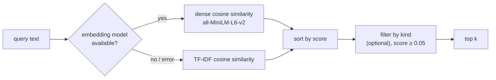

# Feature: Retrieval-augmented generation (RAG)

Keeps the tutor's answers **aligned with what the teacher actually taught** and lets it build on its own
earlier explanations.

* **Endpoint:** [`POST /rag/query`](../api/retrieval.md), plus internal use by [slide generation](slide-generation.md)
* **Code:** `rag.py` (`VectorStore`) and, in `main.py`, `rag_store`, `index_lecture`, `retrieve_reference`, `snippet`

## 1. Concepts

| Term | Meaning |
|---|---|
| **Collection** | All indexed passages of one lecture. Its name is the lecture's `sessionId` |
| **Document** | `{id, text, kind, meta}` |
| **Kind** | `lecture`: a 150-word chunk of the uploaded documents/slides · `transcript`: a chunk of the speech (audio/video) when documents were also uploaded · `explanation`: a slide the tutor generated earlier |

## 2. When documents are indexed

| Moment | What is added |
|---|---|
| End of `POST /analyze-lecture` | **Every** chunk of the lecture text, not just the ones that became topics: ids `chunk-0`, `chunk-1`, ... with `meta {chunkIndex, topicId}` (`topicId` is the `topic-N` the chunk became, or `null`) |
| Same moment, only if documents *and* audio/video were given | The transcript chunks: ids `transcript-0`, ... (kind `transcript`) |
| After each generated slide (except `quiz-results`, `completion`) | One `explanation` document: id = slide id, text = title + narrative + up to 4 key insights, `meta {topicIndex, action}` |

For **transcript-only** lectures the transcript *is* the lecture text, so it is indexed once (as `lecture`),
not twice.

Indexing never fails an upload: errors are logged and ignored.

## 3. How retrieval works



### 3.1 TF-IDF (always available)

* **Tokenisation:** lower-case, `[a-z0-9]+` runs of ≥2 characters, minus a stop-word list (`the`, `and`, `of`, `is`, ...).
* **Weights:** `tf = 1 + ln(count)`, `idf = ln((1 + N) / (1 + df)) + 1`, vector entry = `tf × idf`.
* **Score:** cosine similarity between the query vector and each document vector. The index is rebuilt
  lazily after any change to the collection.

### 3.2 Dense embeddings (when `sentence-transformers` loads)

* All documents of the collection are encoded once (`model.encode`) and cached until the collection changes;
  the query is encoded per request; score = cosine similarity.
* If encoding raises for any reason, that query silently falls back to TF-IDF.

### 3.3 Filtering

Scores are computed for the whole collection and sorted; then documents of the wrong `kind` are skipped and
anything below **`min_score = 0.05`** ends the list. An empty collection, empty query or no match returns `[]`.

## 4. How retrieved passages are used

`retrieve_reference(collection, query, include_explanations)` returns up to **4** `lecture`/`transcript`
passages and, if requested, up to **2** `explanation` passages. They are written into the slide prompt (see
[slide-generation §4](slide-generation.md#4-grounding-with-retrieved-sources)) and the lecture passages are
returned to the client as `slide.metadata.sources` (`id`, `kind`, `snippet` ≈220 chars, `score`).

## 5. Storage format

One JSON file per collection: `data/rag/<name>.json` where `<name>` is the collection name with every
character outside `[A-Za-z0-9_-]` replaced by `_` (max 120 chars).

```json
[
  { "id": "chunk-0", "text": "Hash tables map keys to buckets ...", "kind": "lecture", "meta": { "chunkIndex": 0, "topicId": "topic-1" } },
  { "id": "slide_1792243672369", "text": "Hash Tables and Collisions A hash table maps ...", "kind": "explanation", "meta": { "topicIndex": 0, "action": "ask-question" } }
]
```

Writes are atomic (temp file + `os.replace`). `add()` **replaces** a document with the same id.
Embeddings are **not** persisted; they are recomputed in memory on first use after a restart.

## 6. `VectorStore` API

```python
store = VectorStore(directory, model_getter=lambda: model_or_None)
store.add(name, docs)                 # -> number added/replaced; empty text is skipped
store.query(name, text, k=4, kinds=None, min_score=0.05)   # -> [{id,text,kind,meta,score}, ...]
store.count(name, kind=None)
store.delete(name)                    # removes memory + file
```

`model_getter` may return `None`; any object with `.encode(list[str])` returning vectors works as a model
(tests use a fake). All methods are guarded by a re-entrant lock.

## 7. Operations

| Topic | Notes |
|---|---|
| Growth | A collection grows by one document per generated slide. Typical lectures stay well under a few hundred KB |
| Cleanup | Collections are **not** removed when old plans roll out of `lecture_plans.json`; delete stale files in `data/rag/` periodically (or call `VectorStore.delete`) |
| Re-embedding cost | With the dense model, adding a document invalidates the cached embeddings, so the next query re-encodes the collection. Fine for hundreds of passages |
| Multi-process | The in-memory cache is per process, but files are the source of truth; run one process anyway ([architecture §4](../architecture.md#4-concurrency-model)) |

## 8. Limitations

* Retrieval is by similarity, not by understanding: a question phrased very differently from the lecture can
  miss (dense embeddings help; TF-IDF needs shared words).
* Chunks are fixed-size, so a relevant passage may be cut in two.
* A local JSON store is not a hosted vector database: no ANN index, no multi-user concurrency. It is
  appropriate for hundreds of passages per lecture. See [extending](../guides/extending.md#swap-the-vector-store)
  for replacing it.

## 9. Tests

`test_features.py`: `test_query_ranks_the_relevant_passage_first`, `test_query_filters_by_kind_and_ignores_unrelated`,
`test_add_replaces_by_id_and_persists`, `test_dense_model_is_used_when_available_and_failures_fall_back`,
`test_upload_indexes_all_chunks_and_rag_endpoint_finds_them`, `test_transcript_only_lectures_are_not_indexed_twice`,
`test_transcript_is_indexed_separately_when_slides_are_the_source`,
`test_ask_question_is_grounded_in_retrieved_sources_and_remembered`.
